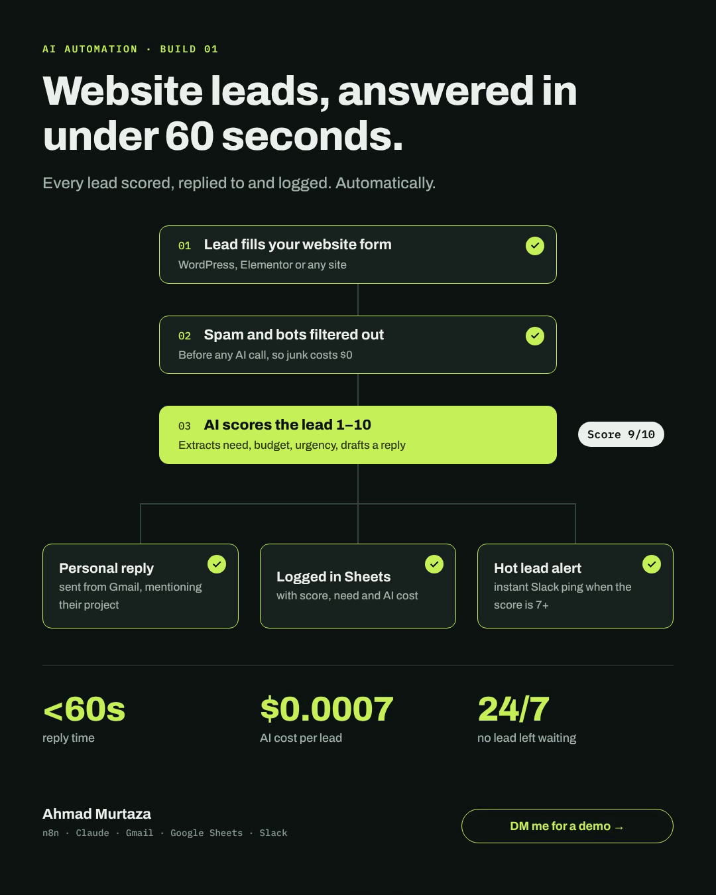

# AI Lead Responder

Website leads answered in under 60 seconds: scored by AI, replied to personally, logged, and flagged when hot.



**Demo video:** [assets/workflow-demo.mp4](assets/workflow-demo.mp4)

**Stack:** n8n · Claude API (Haiku) · Gmail · Google Sheets · Slack · plain HTML/JS form

## How it works

A website form sends each new lead to n8n. Claude scores it (1–10), pulls out the need, budget and urgency, and writes a personal reply. The reply is emailed through Gmail within about a minute, every lead is logged to Google Sheets with its AI cost, and hot leads trigger an instant Slack alert.

```
Form ──► n8n Webhook ──► Validate + spam filter (plain code, $0)
                              │ invalid/spam ──► 400 / silent 200
                              ▼
                      Respond "ok" to the form (fast UX)
                              ▼
                 ONE Claude Haiku call: score + extract + draft reply
                              ▼
                       Parse + compute cost
            ┌─────────────────┼──────────────────┐
            ▼                 ▼                  ▼
     Google Sheet       Gmail reply         Slack alert
     (every lead)   (score ≥ 4, not spam)  (score ≥ 7)

Any node fails 3× ──► Error Handler workflow ──► Slack + email to you
```

## Files

| File | What it is |
|---|---|
| `workflows/ai-lead-responder.json` | Main n8n workflow (import this) |
| `workflows/error-handler.json` | Error alert workflow (import this too) |
| `landing/index.html` | Landing page with the lead form |
| `test/send-test-leads.js` | Sends 10 test leads (hot, warm, cold, spam, prompt injection) |
| `sheet-headers.csv` | Header row for your Google Sheet |

## Cost design

- **One AI call per lead, not two.** Scoring and the reply come from a single Haiku request that returns JSON. That halves cost and latency compared with separate calls.
- **Junk never reaches the AI.** Missing fields, honeypot bots, link spam and disposable emails are filtered in plain JavaScript first.
- **Message capped at 2,000 characters** so nobody can paste a novel and run up your bill.
- **Every lead's token count and cost is logged** in the sheet, which gives you real numbers for your case study and pricing.
- Real cost: about 600 input and 250 output tokens per lead, roughly **$0.0002 per lead**. 500 leads a month is about **$0.10**.

## Setup (about 45 minutes)

### 1. Get n8n running
Use the free **n8n Cloud trial** while learning (fastest), or self-host on a VPS later. Everything below works the same on both.

### 2. Create the Google Sheet
1. Create a new Google Sheet and rename the first tab to **`Leads`**.
2. Paste the contents of `sheet-headers.csv` into row 1 (one header per column).
3. Copy the sheet ID from its URL: `docs.google.com/spreadsheets/d/`**`THIS_PART`**`/edit`.

### 3. Create a Slack webhook (for hot-lead alerts)
1. Go to api.slack.com/apps → **Create New App** → From scratch → pick your workspace.
2. **Incoming Webhooks** → turn on → **Add New Webhook to Workspace** → choose a channel such as `#leads`.
3. Copy the webhook URL (`https://hooks.slack.com/services/...`).

### 4. Get a Claude API key
console.anthropic.com → **API Keys** → create one. Under **Billing → Limits**, set a low monthly spend limit (e.g. $5) so a bug can never cost you real money.

### 5. Import the workflows
1. In n8n: **Workflows → Import from File** → `workflows/error-handler.json`. Save it.
2. Import `workflows/ai-lead-responder.json`.

### 6. Add credentials in n8n
| Node | Credential type | Settings |
|---|---|---|
| Claude: Score + Draft Reply | **Header Auth** | Name: `x-api-key`, Value: your Claude API key. Save it as "Anthropic API". |
| Gmail: Send Reply (and Gmail: Error Alert) | **Gmail OAuth2** | Sign in with the Gmail account that should send replies. |
| Save to Google Sheet | **Google Sheets OAuth2** | Same Google account that owns the sheet. |

Open each of those nodes and select the credential.

### 7. Edit the settings
1. **Validate Lead** node: edit the `CONFIG` block at the top: business description, your booking link, Slack webhook URL. This is the only place you change prompts and thresholds.
2. **Save to Google Sheet** node: replace `PASTE_YOUR_SHEET_ID` with your sheet ID.
3. In the **Error Handler** workflow, edit the **Build Error Message** node: Slack URL and your email.
4. In the main workflow: **⋯ → Settings → Error Workflow** → choose **Error Handler**. Save.

### 8. Activate and connect the form
1. Toggle the main workflow **Active**.
2. Open the **Lead Webhook** node and copy the **Production URL**.
3. Paste it into `WEBHOOK_URL` in `landing/index.html`.
4. Host the landing page anywhere: a subdomain on your Hostinger plan works fine (upload the single HTML file).

> n8n's *Test URL* (`/webhook-test/...`) only accepts one request each time you click "Listen for test event". Use the **Production URL** with the workflow active for the test script.

### 9. Run the 10 test leads
```bash
node test/send-test-leads.js https://YOUR-N8N/webhook/lead-capture you@gmail.com
```
All replies go to `you+lead1@gmail.com`, `you+lead2@gmail.com`… so they land in **your** inbox.

What a passing run looks like:
- 3 hot leads → Slack alert + personal reply with booking link
- 3 warm leads → reply, no alert
- Job seeker, SEO pitch and prompt-injection lead → logged with low scores, **no reply sent**
- Spam lead → filtered before the AI, never appears in the sheet

## Using it on WordPress / Elementor

**Elementor Pro form:** Actions After Submit → add **Webhook** → paste the Production URL → tick **Advanced Data**. In each field's *Advanced* tab, set the Field ID to `name`, `email`, `phone`, `company`, `service`, `budget`, `message`. The workflow already understands Elementor's format.

**WPForms, Fluent Forms, Gravity Forms:** use their webhook add-on with the same field names. Plain JSON or form posts both work.

## Make the portfolio pieces
1. **Loom (2 min):** submit a hot lead on the landing page → show the reply arriving in Gmail → the Slack alert → the sheet row with score and cost. Then show the prompt-injection lead getting a low score.
2. **Case study numbers** (from your sheet): average response time, % of spam filtered for free, cost per lead.
3. **LinkedIn post:** "Most agencies reply to leads in hours. This replies in under a minute, for $0.0002 per lead."
4. **GitHub:** push this folder. **Never commit API keys**; they live only in n8n credentials.

## Selling it (later)
"AI Lead Responder" for real estate agents, clinics and agencies: $150–300 setup + $29–79/month. For each pilot client, duplicate the workflow, change the `CONFIG` block and connect their Gmail and Sheet. The multi-tenant version (one workflow, settings loaded per client from a database) comes after 2–3 paying pilots.

## Troubleshooting
| Problem | Fix |
|---|---|
| Form shows "Failed to fetch" | Workflow not active, wrong URL, or a CORS block. The webhook allows all origins; check the URL first. |
| Claude node: 401 | Header Auth name must be exactly `x-api-key`. |
| Claude node: 400 model error | Check the `model` value in CONFIG against the current model list in the Claude docs. |
| Sheet node: column error | Row 1 must match `sheet-headers.csv` exactly, and the tab must be named `Leads`. |
| Lead flagged "needs manual review" | Claude returned invalid JSON. The lead is still saved and alerted, never lost. |

## Author

Built by **Ahmad Murtaza**, AI automation and web developer. Want this set up for your business? Get in touch via [LinkedIn](https://www.linkedin.com/) or [Upwork](https://www.upwork.com/freelancers/ahmadmurtaza31).
